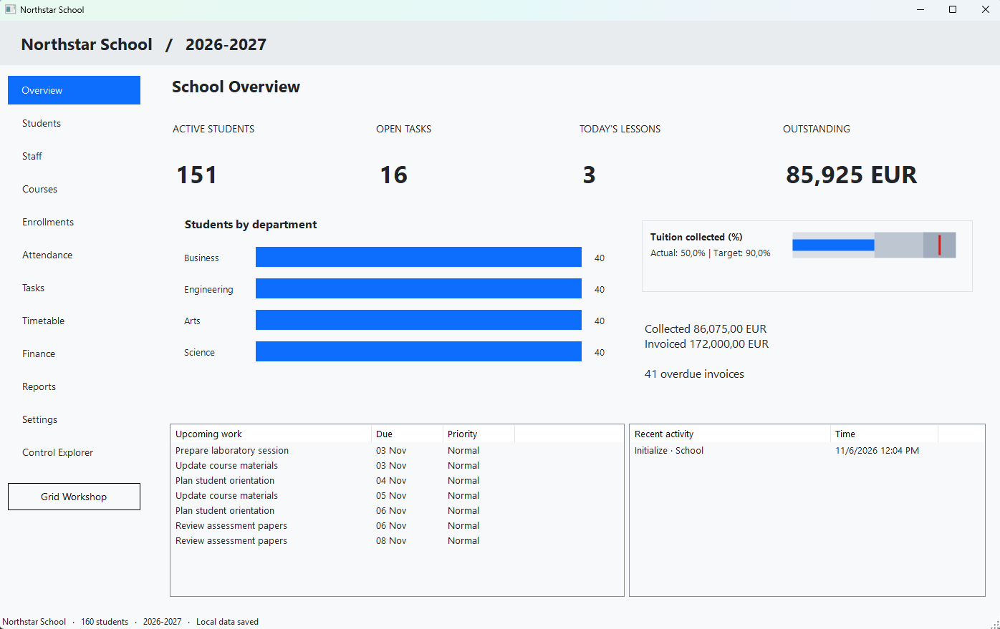

# Northstar School

Northstar School is an offline Windows desktop sample for managing day-to-day school operations. It is built with Windows Forms and EnterpriseUI components.



## Features

- Dashboard with student, task, lesson, and finance summaries
- Student, staff, course, and enrollment management
- Attendance records and batch roll call
- Task list and draggable task board
- Timetable with room and teacher conflict validation
- Invoices, payment recording, and outstanding balances
- Attendance, course results, activity, and outstanding-fee reports
- CSV, JSON, XML, HTML, XLSX, and PDF export; print preview
- Search, filtering, sorting, grouping, paging, column layouts, and summaries
- Theme selection, theme JSON editing, and control explorer
- Backup and restore from Settings

The **Grid Workshop** is a separate feature showcase; it is not the school’s operational student screen.

## Requirements

- Windows 10 or later
- .NET 10 SDK
- `EnterpriseUI.WinForms` version `1.0.0` available from a configured NuGet package source

## Run

From the repository root:

```powershell
dotnet restore .\TestDataGrid\TestDataGrid.csproj
dotnet run --project .\TestDataGrid\TestDataGrid.csproj
```

If restoring from a local EnterpriseUI package feed:

```powershell
dotnet restore .\TestDataGrid\TestDataGrid.csproj --source C:\LocalNugetPackages
```

## Data and Backups

The app creates sample school records on first launch and stores changes in:

```text
%LOCALAPPDATA%\NorthstarSchool\school.json
```

Use **Settings → Backup** to export a backup or **Settings → Restore** to restore one. Restore replaces the current local dataset. The timetable, enrollment, attendance, and finance views share the same records, and cross-record rules reject invalid changes.

## Verification

Run the isolated school workflow checks:

```powershell
dotnet run --project .\TestDataGrid\TestDataGrid.csproj -- --verify-school
```

The existing grid feature checks can be run with:

```powershell
dotnet run --project .\TestDataGrid\TestDataGrid.csproj -- --verify-grid
```

Both verification modes use test data and do not replace the normal app’s saved school file.
