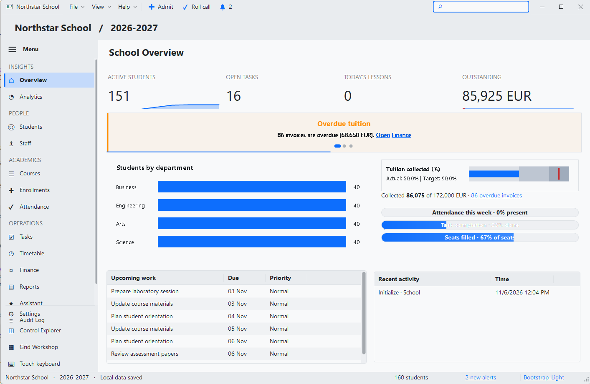

# Northstar School

Northstar School is an offline Windows desktop sample for managing day-to-day school operations. It is built with Windows Forms and EnterpriseUI components.



## Features

- Dashboard with student, task, lesson, and finance summaries
- Analytics: enrollment pivot, attendance and room-booking heat maps, outstanding-fees tree map
- Student, staff, course, and enrollment management, each as a grid with an optional card view, faceted filters and a filter builder
- Course catalog tree that filters the course list
- Attendance records, batch roll call and a per-course roll call with tick lists
- Task list and draggable task board
- Timetable with room and teacher conflict validation
- Invoices, payment recording, and outstanding balances
- Attendance, course results, activity, and outstanding-fee reports
- Audit log in a virtual grid
- CSV, JSON, XML, HTML, XLSX, and PDF export; print preview
- Search, filtering, sorting, grouping, paging, column layouts, and summaries
- Validated settings form, theme selection in a property inspector, theme JSON editing, and control explorer
- Backup and restore from Settings
- Assistant: a chat that answers questions from the live records and a prompt that drafts fee reminders, attendance notes, course summaries and announcements (offline, no AI service needed)
- Admit Student wizard: details, courses with seat checks, tuition, review; creates the student, enrollments and invoice in one step
- Course ratings (half stars) on enrollments, a course showcase gallery, and rotating announcements on the overview
- Tray icon with an unread count and toasts for overdue fees, due tasks, today's lessons and recorded payments
- Voice search and note dictation (Windows speech recognition), inline writing help in notes, smart paste of contact details
- Touch keyboard that follows the focused text box, page tips, and a busy indicator for exports and backups
- Themed window frame with a title bar that holds menus (File, View with theme and lesson widget, Help), Admit and Roll call buttons, a notification bell with the unread count, and a search box that asks the assistant
- Status bar with the student count, a live "new alerts" link that opens the notification centre, and the active theme
- Notification centre as a slide-in flyout, and a start-of-day briefing alert (pin, options and links to Finance, Tasks or Timetable; switch it off in Settings)
- Taskbar integration: busy indicator, unread badge, and Overview / Roll call / Assistant thumbnail buttons
- Busy overlay that dims and blocks the screen during exports and backups, and toasts with Open / Show in folder actions when they finish
- Multi-window workspace (File → New workspace window): screens open in tabs, and a tab can be dragged out to another monitor
- Floating lesson widget (View → Lesson widget) with the lesson in progress and the next one
- Task dialogs for removing records (archive or delete) and for restoring a backup (with an optional safety backup), markup dialogs for questions, About box and What's new
- Splash screen while the school records load
- **Grid Workshop** with a ribbon: Home, Query, Output, Layout and Tools tabs, quick access buttons, and a contextual "Pending changes" tab while edits are unsaved
- Control Explorer previews every control and has a Shell menu for the dialogs, alerts, overlay and flyout, and a shape editor that previews the drawn outline as a window

The **Grid Workshop** is a separate feature showcase; it is not the school’s operational student screen.

## Requirements

- Windows 10 or later
- .NET 10 SDK
- `EnterpriseUI.WinForms` version `1.1.0` available from a configured NuGet package source
- A Windows speech recognizer (installed with most Windows languages) for voice search and dictation; without one the Voice and Dictate buttons explain why they are unavailable

## Run

From the repository root:

```powershell
dotnet restore .\TestDataGrid\TestDataGrid.csproj
dotnet run --project .\TestDataGrid\TestDataGrid.csproj
```

If restoring from a local EnterpriseUI package feed:

```powershell
dotnet restore .\TestDataGrid\TestDataGrid.csproj --source C:\LocalNugetPackages
```

## Data and Backups

The app creates sample school records on first launch and stores changes in:

```text
%LOCALAPPDATA%\NorthstarSchool\school.json
```

Use **Settings → Backup** to export a backup or **Settings → Restore** to restore one. Restore replaces the current local dataset. The timetable, enrollment, attendance, and finance views share the same records, and cross-record rules reject invalid changes.

## Verification

Run the isolated school workflow checks:

```powershell
dotnet run --project .\TestDataGrid\TestDataGrid.csproj -- --verify-school
```

The existing grid feature checks can be run with:

```powershell
dotnet run --project .\TestDataGrid\TestDataGrid.csproj -- --verify-grid
```

Both verification modes use test data and do not replace the normal app’s saved school file.
